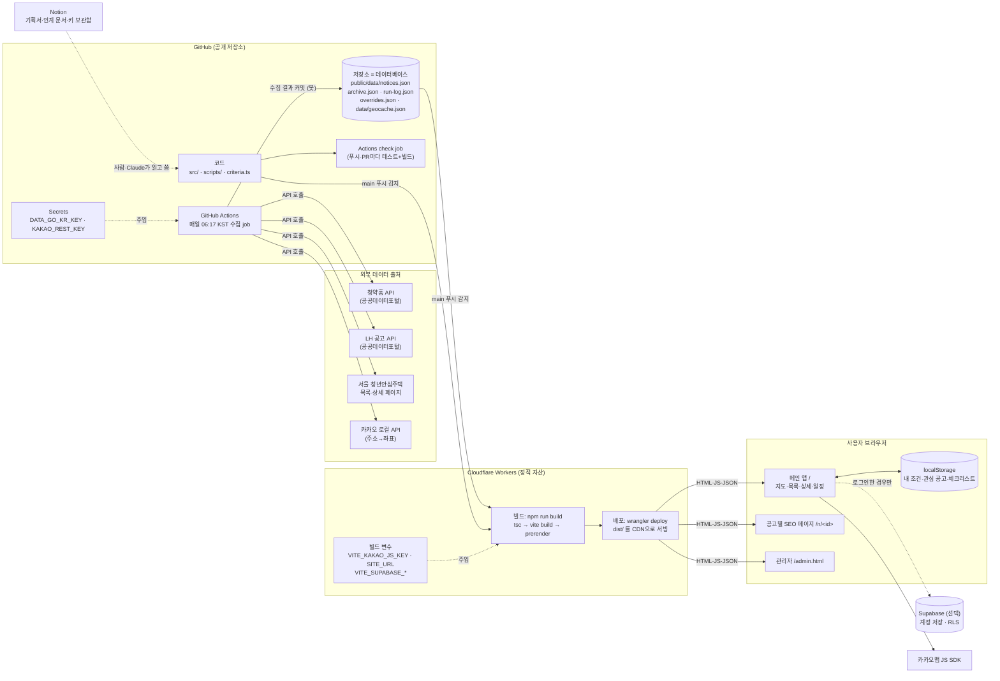
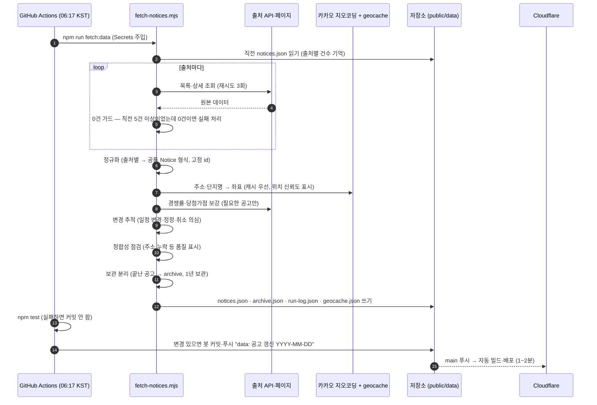
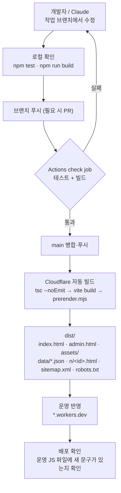
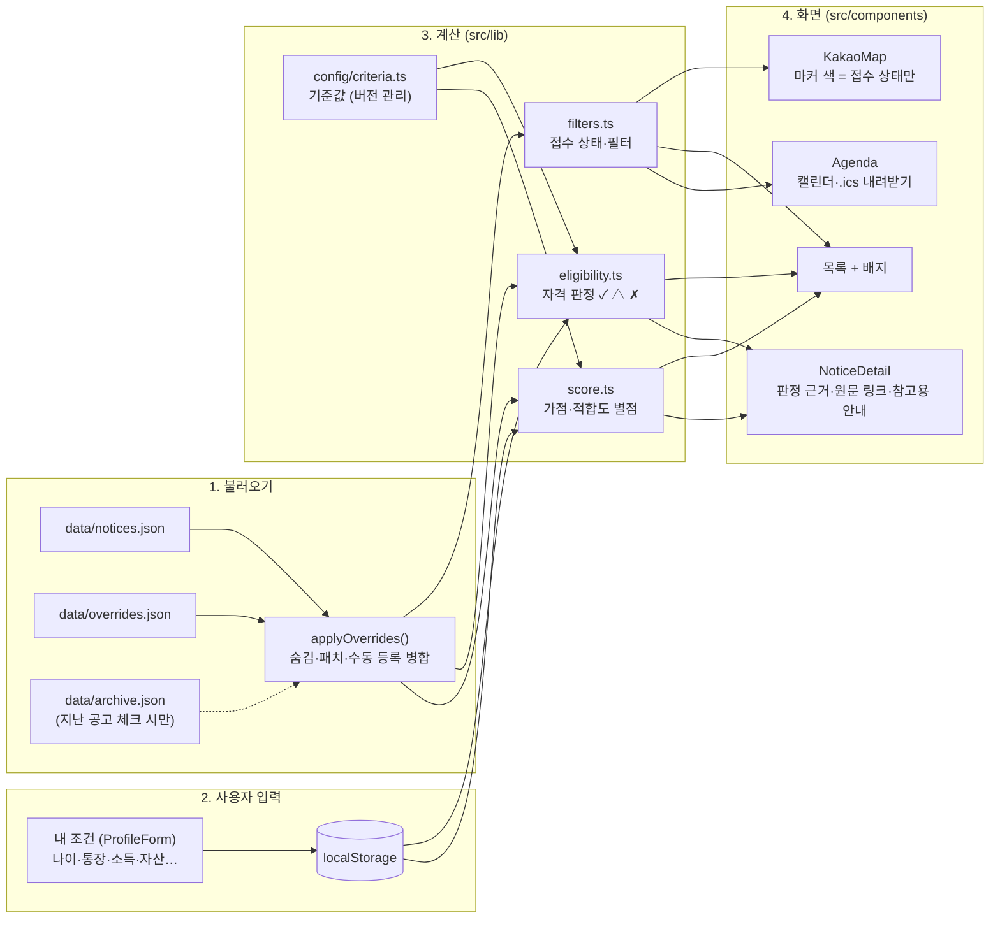
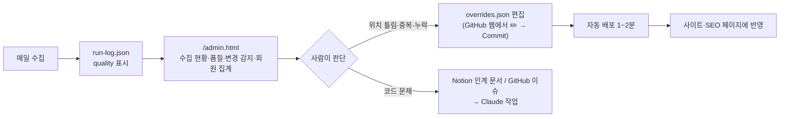
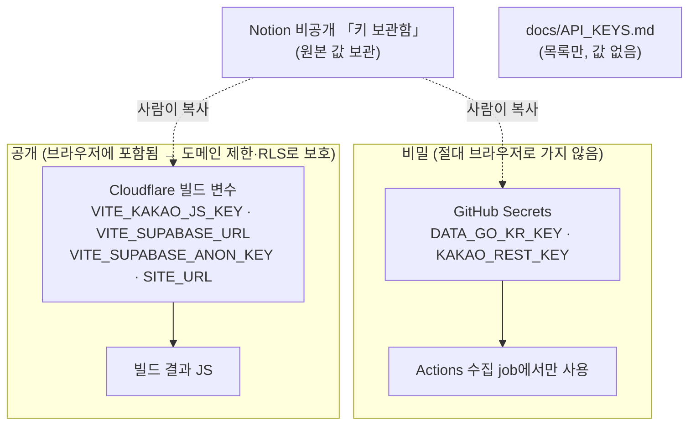
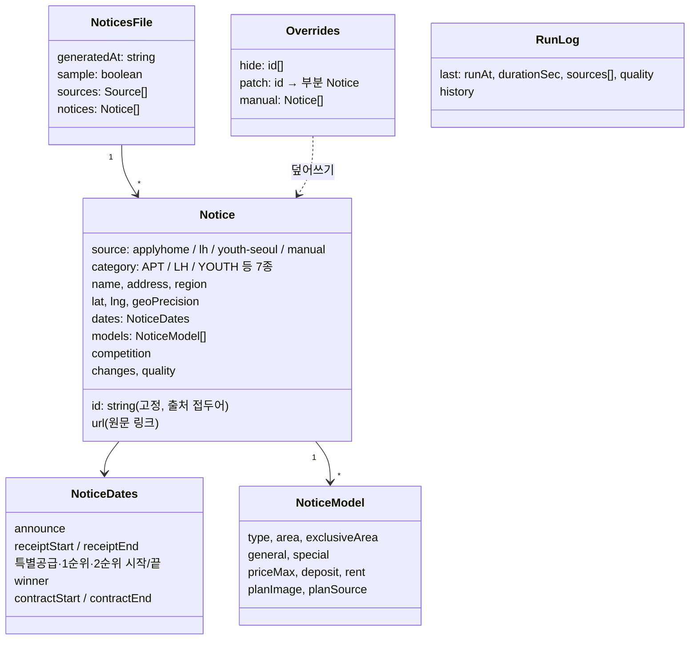
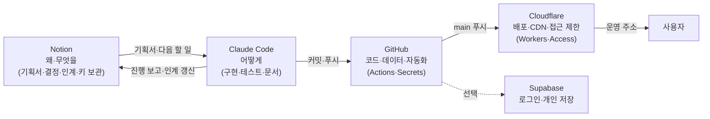

# 청약맵 시스템 구성도 (기본 구성도 v1)

> 이 문서는 **청약맵(dash_housing)** 의 실제 구성과 작동 원리를 정리한 것이며,
> 새 대시보드를 만들 때 그대로 가져다 쓰는 **기본 구성도(레퍼런스 아키텍처)** 입니다.
> 새 프로젝트를 시작할 때는 「새 프로젝트 기획서」 + 이 문서를 함께 주고 시작합니다 (부록 A 참고).
>
> - 작성 기준일: 2026-11-13 · 기준 커밋: `bf273b9`
> - 그림은 Mermaid로 그렸습니다. GitHub에서 열면 그림으로 보이고, Notion에서는 코드 블록의 「미리보기」로 봅니다.

---

## 0. 한 줄 요약

**"서버 없이, 매일 한 번 데이터를 모아 JSON 파일로 저장소에 커밋하면, 그 커밋이 곧 배포가 되고, 계산은 모두 사용자 브라우저가 한다."**

| 역할 | 무엇이 맡나 | 비용 |
|---|---|---|
| 데이터 수집 (배치 서버 역할) | GitHub Actions 예약 실행 (매일 06:17 KST) | 무료 |
| 데이터베이스 역할 | 저장소 안의 JSON 파일 (`public/data/*.json`) + Git 이력 | 무료 |
| 웹 서버·CDN | Cloudflare Workers 정적 자산 (`main` 푸시 시 자동 빌드·배포) | 무료 |
| 계산 엔진 (판정·점수·필터) | 사용자 브라우저 (React + TypeScript) | 무료 |
| 개인 저장 (선택) | 기본 localStorage, 켠 경우에만 Supabase(RLS) | 무료 범위 |
| 기획·결정·인계 기록 | Notion | 무료 |
| 관리자 기능 | `/admin.html` (읽기 전용) + `overrides.json` 편집 (= Git 커밋) | 무료 |

---

## 1. 전체 구성도



**핵심 포인트**
1. 실행 중인 서버가 없습니다. 움직이는 것은 ① 하루 한 번 도는 Actions, ② 푸시 때 도는 Cloudflare 빌드, ③ 사용자 브라우저뿐입니다.
2. 키는 두 종류로 나뉩니다. **비밀 키**(수집용)는 GitHub Secrets에만, **공개 키**(브라우저용, 도메인 제한 필수)는 Cloudflare 빌드 변수에만 둡니다.
3. 데이터 변경 = Git 커밋입니다. 그래서 모든 데이터 변경 이력이 자동으로 남고, 문제가 생기면 `git revert`로 되돌릴 수 있습니다.

---

## 2. 작동 개념 ① — 매일 데이터 수집 파이프라인



**안전장치 (새 대시보드에도 그대로 적용 권장)**

| 장치 | 위치 | 효과 |
|---|---|---|
| 재시도 + 지수 대기 | `getJson()` | 일시적 네트워크 오류 흡수 |
| **0건 가드** | `assertNotEmpty()` | 출처가 갑자기 비면 수집 실패 → 직전 데이터 유지 (사이트가 텅 비는 사고 방지) |
| 고정 id | 출처 접두어 `ah-` `lh-` `ys-` `manual-` | 즐겨찾기·링크·보정값이 매일 수집에도 유지 |
| 좌표 캐시 | `data/geocache.json` | API 호출 수 절감, 결과 안정 |
| 수집 후 테스트 | Actions `npm test` | 깨진 데이터가 배포되지 않음 |
| 변경 없으면 커밋 안 함 | `git diff --cached --quiet` | 불필요한 배포 방지 |
| 실행 기록 | `run-log.json` | 관리자페이지에서 출처별 성공·건수·소요시간 확인 |

---

## 3. 작동 개념 ② — 코드 변경과 배포



- `prerender.mjs`는 빌드 직후 공고마다 정적 HTML(`/n/<id>`)과 사이트맵을 만듭니다. 자바스크립트를 실행하지 않는 검색엔진도 내용을 읽을 수 있게 하기 위함입니다.
- 캐시 정책(`public/_headers`): `/data/*` 10분, `/assets/*` 1년(파일명에 해시가 붙으므로 안전).
- SPA 라우팅: `wrangler.jsonc`의 `not_found_handling: "single-page-application"`.

---

## 4. 작동 개념 ③ — 브라우저 안에서 일어나는 일



**설계 원칙**
- **개인정보는 서버로 가지 않습니다.** 소득·자산 같은 입력값은 브라우저에서만 계산합니다. 계정 저장은 사용자가 직접 켠 경우에만 Supabase에 저장합니다.
- **기준값은 한 곳에서 버전으로 관리합니다** (`criteria.ts`). 기준이 바뀌면 새 버전을 추가하고, 공고의 모집공고일로 맞는 버전을 고릅니다. 기존 버전은 지우지 않습니다.
- **색 하나에 의미 하나** (`tokens.ts`). 지도 색 = 접수 상태, 판정 = 배지 기호.
- **화면 실험은 스위치로** (`ui.ts`). 디자인을 바꿀 때 켜고 끌 수 있게 하고, 스타일은 한 블록(`.app.ed`)에만 둡니다.
- **판정 화면에는 항상 "참고용 안내" + 원문 링크.**

---

## 5. 작동 개념 ④ — 운영·관리 루프 (서버 없는 관리자)



- 관리자 화면은 **읽기 전용**입니다. 수정은 GitHub 로그인이 필요한 파일 편집으로만 합니다 → 별도 인증 서버가 필요 없습니다.
- 수동 보정(`hide` / `patch` / `manual`)은 수집 데이터 위에 덮어씌우므로, 다음 날 수집에도 보정이 유지됩니다.
- 관리자 페이지 접근 제한이 필요하면 Cloudflare Access(이메일 인증, 50명 무료)를 경로에 겁니다.

---

## 6. 키·비밀값 배치도



| 규칙 | 이유 |
|---|---|
| 저장소는 공개 → 키·토큰·개인정보 커밋 금지 | 누구나 읽을 수 있음 |
| `VITE_` 접두어 = 브라우저에 노출되는 값 | Vite가 빌드 결과에 그대로 넣음 |
| 브라우저 키는 반드시 도메인 제한 | 카카오 JS 키 도용 방지 |
| Supabase anon 키는 공개 가능, 대신 RLS 필수 | 본인 행만 접근 |
| 키 목록은 저장소 문서, 값은 Notion 비공개 | 인계 시 누락 방지 + 유출 방지 |

---

## 7. 데이터 모델 (공통 형식)



> 새 대시보드에서는 `Notice` 자리에 그 도메인의 핵심 항목(예: 행사, 매물, 채용 공고, 지원사업…)을 두고,
> **고정 id · 출처 · 위치 · 날짜 묶음 · 원문 링크 · 품질 표시** 여섯 가지는 그대로 유지하는 것을 권장합니다.

---

## 8. 저장소 구조 (그대로 복제 가능한 뼈대)

```
<project>/
├─ CLAUDE.md                  # Claude 작업 가이드 (새 대화가 가장 먼저 읽음)
├─ README.md                  # 기능·설정 순서
├─ wrangler.jsonc             # Cloudflare 정적 자산 배포 설정
├─ .github/workflows/deploy.yml  # check(푸시·PR) + collect(예약 수집)
├─ public/
│  ├─ _headers                # 캐시 정책
│  └─ data/                   # ← "데이터베이스"
│     ├─ <items>.json         #   현재 데이터
│     ├─ archive.json         #   지난 데이터
│     ├─ run-log.json         #   수집 기록
│     └─ overrides.json       #   관리자 수동 보정
├─ data/geocache.json         # 수집용 캐시 (배포 안 됨)
├─ scripts/
│  ├─ fetch-<items>.mjs       # 수집 메인
│  ├─ lib/                    # geo · track · quality (+ 테스트)
│  ├─ sources/                # 출처별 파서
│  └─ prerender.mjs           # SEO 정적 페이지·sitemap
├─ src/
│  ├─ App.tsx · types.ts
│  ├─ components/             # 지도·목록·상세·일정
│  ├─ lib/                    # 순수 함수 계산 로직 (+ *.test.ts)
│  ├─ config/                 # criteria(기준값) · tokens(색) · ui(스위치)
│  └─ admin/                  # 관리자페이지
├─ supabase/schema.sql        # (선택) 계정 저장 + RLS
└─ docs/                      # ARCHITECTURE · ADMIN · ACCOUNT · API_KEYS
```

---

## 9. 도구별 역할 분담



| 도구 | 맡는 일 | 청약맵에서의 실제 사용 |
|---|---|---|
| **Notion** | 기획서, 진행 보고, 결정 대기, 인계 문서, 키 보관함(비공개) | 「청약맵 기획서」, 「인계 문서 (새 대화 시작용)」, 「API 키 보관함」 |
| **GitHub** | 코드·데이터 저장, 예약 수집, CI, 비밀 키 | 공개 저장소, `deploy.yml`, Secrets 2개 |
| **Cloudflare** | 빌드·배포·CDN, 공개 빌드 변수, (선택) Access | Workers 프로젝트 `dash-housing` |
| **Supabase** (선택) | 로그인·개인 데이터 저장 | 카카오·구글 로그인, RLS 테이블 3개 |
| **Claude Code** | 구현, 테스트, 문서·인계 갱신 | 작업 브랜치에서 개발 후 `main` 반영 |

---
---

# 부록

## 부록 A. 새 대시보드 시작 요청 템플릿 (Claude에게 그대로 붙여넣기)

```text
새 대시보드를 만들려고 해. 아래 두 문서를 기준으로 진행해줘.

1) 기획서: <Notion 기획서 링크 또는 본문>
2) 기본 구성도: dash_housing 저장소 docs/ARCHITECTURE.md (청약맵 기본 구성도 v1)

[조건]
- 구성: 기본 구성도와 같은 "서버 없는 정적 사이트 + GitHub Actions 예약 수집 + JSON 커밋 + Cloudflare Workers 자동 배포"
- 저장소: <새 저장소 이름> (공개/비공개: <선택>)
- 데이터 출처: <API·페이지 목록, 갱신 주기>
- 화면: <지도/표/차트/캘린더 중 무엇>, 사용자 입력: <무엇, 서버로 보내지 않음>
- 계정 기능: <필요 없음 / Supabase>
- 도구: GitHub(코드·Actions·Secrets), Notion(기획서·인계 문서), Cloudflare(배포)

[먼저 할 일]
1. 기획서를 읽고 구성도 대비 달라지는 점을 정리해서 확인받기
2. 저장소 뼈대(부록 C) + CLAUDE.md + docs/ARCHITECTURE.md 만들기
3. 샘플 데이터로 화면이 뜨는 첫 버전 → 수집 스크립트 → 배포 순서로 진행
4. Notion에 인계 문서 페이지 만들기
```

## 부록 B. 기획서 템플릿 (Notion에 복사해서 채우기)

| 항목 | 채울 내용 | 청약맵 예시 |
|---|---|---|
| 한 줄 정의 | 누가, 무엇을, 어디서 본다 | 전국 청약 공고를 지도에서 보고 내 자격을 참고 판정 |
| 사용자 | 주 사용자와 상황 | 청약을 준비하는 무주택자 |
| 핵심 데이터 | 항목 단위, 출처, 갱신 주기, 이용 조건 | 청약 공고 / 청약홈·LH API / 매일 |
| 고정 id 규칙 | 출처별 접두어 | `ah-` `lh-` `ys-` `manual-` |
| 화면 | 메인 뷰, 목록, 상세, 보조 뷰 | 지도 + 목록 + 상세 + 일정 캘린더 |
| 계산 로직 | 브라우저에서 할 판정·점수 | 자격 판정, 가점, 적합도 |
| 기준값 | 바뀌는 숫자와 근거, 버전 관리 여부 | 소득·자산 기준 (연도별 버전) |
| 개인정보 | 무엇을 입력받고 어디 저장 | localStorage, 선택 시 Supabase |
| 관리자 | 확인할 지표, 수동 보정 범위 | 수집 현황·품질·숨김·좌표 수정 |
| 수익·노출 | SEO, 광고, 공유 | 공고별 정적 페이지, 애드센스 자리 |
| 하지 않을 것 | 범위 밖 | SH 자동 수집(robots 차단) |
| 마일스톤 | v0.1 / v0.2 / v0.3 | 지도 표시 → 판정 → 계정·관리자 |

## 부록 C. 새 프로젝트 체크리스트 (순서대로)

**1. 준비 (사람)**
- [ ] Notion: 기획서 페이지, 인계 문서 페이지, 키 보관함(비공개) 만들기
- [ ] 데이터 출처 이용 조건·robots.txt 확인, API 키 발급
- [ ] GitHub 저장소 생성 (공개면 키 커밋 절대 금지)

**2. 뼈대 (Claude)**
- [ ] Vite + React + TypeScript, 런타임 의존성 최소화
- [ ] `CLAUDE.md`, `README.md`, `docs/ARCHITECTURE.md`, `docs/API_KEYS.md`(값 없음), `.env.example`
- [ ] `src/types.ts`에 공통 항목 형식, `src/config/`(기준값·색 토큰·UI 스위치)
- [ ] `scripts/make-sample.mjs`로 키 없이도 화면이 뜨게
- [ ] `src/lib/*.test.ts` — 계산 로직은 순수 함수 + 단위 테스트 (`node --test`)

**3. 수집**
- [ ] `scripts/fetch-<items>.mjs`: 재시도 · 0건 가드 · 정규화 · 고정 id · 캐시 · 변경 추적 · 품질 표시 · 보관 분리 · run-log
- [ ] `.github/workflows/deploy.yml`: `check`(푸시·PR) + `collect`(cron + 수동 실행), `permissions: contents: write`
- [ ] GitHub Secrets 등록 → Actions 「Run workflow」로 첫 수집

**4. 배포**
- [ ] `wrangler.jsonc` (assets.directory = `./dist`, SPA 처리)
- [ ] Cloudflare → Workers 및 Pages → 저장소 연결, 빌드 `npm run build`, 배포 `npx wrangler deploy`
- [ ] 빌드 변수: `VITE_*` 공개 키, `SITE_URL`
- [ ] 외부 SDK(카카오 등) 도메인에 `*.workers.dev` 주소 등록
- [ ] `public/_headers` 캐시 정책, `prerender.mjs`로 SEO 페이지·sitemap

**5. 운영**
- [ ] `/admin.html` (수집 현황·품질·변경 감지) + `overrides.json`
- [ ] (선택) Cloudflare Access로 관리자 경로 잠금
- [ ] (선택) Supabase 계정 저장 — `schema.sql` + RLS, 이메일 미수집
- [ ] Notion 인계 문서에 현재 상태·다음 할 일·결정 대기 기록

## 부록 D. 재사용 코드 조각

**D-1. 워크플로 (`.github/workflows/deploy.yml`)**
```yaml
name: 데이터 수집
on:
  schedule:
    - cron: '17 21 * * *'   # UTC 기준 → 06:17 KST. 정각(00분)은 지연이 잦아 피함
  workflow_dispatch:
  push: { branches: [main] }
  pull_request:
permissions: { contents: write }
concurrency: { group: collect-${{ github.ref }}, cancel-in-progress: false }
jobs:
  check:
    if: github.event_name == 'push' || github.event_name == 'pull_request'
    runs-on: ubuntu-latest
    steps:
      - uses: actions/checkout@v4
      - uses: actions/setup-node@v4
        with: { node-version: 22, cache: npm }
      - run: npm ci
      - run: npm test
      - run: npm run build
  collect:
    if: github.event_name == 'schedule' || github.event_name == 'workflow_dispatch'
    runs-on: ubuntu-latest
    env:
      SOURCE_API_KEY: ${{ secrets.SOURCE_API_KEY }}
    steps:
      - uses: actions/checkout@v4
      - uses: actions/setup-node@v4
        with: { node-version: 22, cache: npm }
      - run: npm ci
      - if: ${{ env.SOURCE_API_KEY != '' }}
        run: npm run fetch:data
      - run: npm test
      - run: |
          git config user.name "github-actions[bot]"
          git config user.email "41898282+github-actions[bot]@users.noreply.github.com"
          git add -A public/data data
          git diff --cached --quiet && echo "변경 없음" && exit 0
          git commit -m "data: 갱신 $(TZ=Asia/Seoul date +%F)"
          git push
```

**D-2. 배포 설정 (`wrangler.jsonc`)**
```jsonc
{
  "name": "<project>",
  "compatibility_date": "2026-09-01",
  "assets": { "directory": "./dist", "not_found_handling": "single-page-application" }
}
```

**D-3. 캐시 정책 (`public/_headers`)**
```
/data/*
  Cache-Control: public, max-age=600
/assets/*
  Cache-Control: public, max-age=31536000, immutable
```

**D-4. 0건 가드 (수집 스크립트)**
```js
// 직전에 5건 이상이던 출처가 오류 없이 0건 → 일시 장애로 보고 이번 수집 실패 처리(직전 데이터 유지)
function assertNotEmpty(source, count, prevCount) {
  if (count === 0 && (prevCount[source] ?? 0) >= 5)
    throw new Error(`${source}: 0건 (직전 ${prevCount[source]}건) — 직전 데이터 유지`);
}
```

**D-5. 수동 보정 병합 (브라우저·prerender 공용)**
```js
export function applyOverrides(items, ov) {
  if (!ov) return items;
  const hide = new Set(ov.hide ?? []);
  const out = items.filter((n) => !hide.has(n.id)).map((n) => (ov.patch?.[n.id] ? { ...n, ...ov.patch[n.id] } : n));
  const ids = new Set(out.map((n) => n.id));
  for (const m of ov.manual ?? []) if (m?.id && !ids.has(m.id) && !hide.has(m.id)) out.push({ ...m, manual: true });
  return out;
}
```

**D-6. 기준값 버전 선택**
```ts
// 새 기준은 배열 맨 앞에 추가. 기존 버전은 지우지 않는다.
export const VERSIONS = [{ id: '2026', effectiveFrom: '2026-01-01', /* … */ }, { id: '2025', effectiveFrom: '2025-01-01' }];
export const criteriaFor = (date?: string) => VERSIONS.find((v) => !date || date >= v.effectiveFrom) ?? VERSIONS.at(-1)!;
```

## 부록 E. 이 구성을 쓰면 좋은 경우 / 바꿔야 하는 경우

| 상황 | 판단 |
|---|---|
| 데이터가 하루~몇 시간 단위로 바뀜, 수천 건 이하 | ✅ 그대로 사용 |
| 공개 데이터, 사용자별 계산은 브라우저에서 가능 | ✅ 그대로 사용 |
| 수 분 단위 실시간 갱신 필요 | ⚠️ cron 주기를 줄이거나(최소 5분, 정확도 낮음) Workers 함수 + KV/D1 추가 검토 |
| JSON이 수 MB를 넘음 | ⚠️ 지역·월별로 파일 분할, 필요한 파일만 불러오기 |
| 사용자 간 공유 데이터(댓글·투표) 필요 | ⚠️ Supabase 테이블 추가 (RLS 필수) |
| 비밀 키로 사용자 요청마다 외부 API 호출 필요 | ⚠️ Cloudflare Workers 함수(프록시) 추가, 키는 Workers Secret |
| 비공개 데이터·사내 데이터 | ⚠️ 비공개 저장소 + Cloudflare Access 필수 |

## 부록 F. 청약맵에서 얻은 교훈 (다시 겪지 않기)

1. **출처는 예고 없이 비어 있을 수 있다.** 청약홈은 자정 무렵 갱신 중에 0건을 돌려준다 → 0건 가드, 수집 시각은 이른 아침.
2. **id는 처음부터 고정한다.** id가 바뀌면 관심 목록·링크·보정이 모두 깨진다.
3. **같은 의미의 숫자도 기준이 다르다.** 공급면적과 전용면적을 혼동하기 쉽다 → 형식에 단위·기준을 주석으로 명시하고 변환 함수 하나만 쓴다.
4. **위치는 신뢰도를 함께 저장한다** (`address` / `district` / `region`). 관리자 품질 화면에서 보정 대상을 바로 찾는다.
5. **봇 커밋은 "Unverified"로 보인다.** 정상이며, 고치려고 `main`을 강제 푸시하지 않는다.
6. **크롤링 전에 robots.txt와 이용 조건부터.** 막혀 있으면 수동 등록(`manual`)으로 대체한다.
7. **디자인 실험은 스위치로.** 되돌리기가 커밋 한 줄이 된다.
8. **"참고용"과 원문 링크는 모든 판정 화면에.** 법적·신뢰 문제 예방.
9. **대화 하나에 주제 하나.** 주제가 바뀌면 새 대화를 열고, 인계 문서를 갱신한다.

## 부록 G. 무료 범위 참고 (2026-11 기준, 변동 가능하니 시작 시 재확인)

| 서비스 | 주의할 한도 |
|---|---|
| GitHub Actions | 공개 저장소 무료. 예약 실행은 지연·생략될 수 있음, 60일간 저장소 활동이 없으면 예약 비활성화 |
| Cloudflare Workers 정적 자산 | 정적 파일 요청 무료·무제한, 파일당 크기·파일 수 한도 있음 |
| Supabase 무료 | 7일간 요청 없으면 일시정지 → 대시보드에서 Restore |
| 공공데이터포털 | API별 일일 호출 한도 (개발계정/운영계정 구분) |
| 카카오 로컬 API | 일일 호출 한도 → 좌표 캐시 필수 |

## 부록 H. 변경 이력

| 버전 | 날짜 | 내용 |
|---|---|---|
| v1 | 2026-11-13 | 청약맵 기준 최초 작성 (구성도 9종 + 부록 A~H) |
